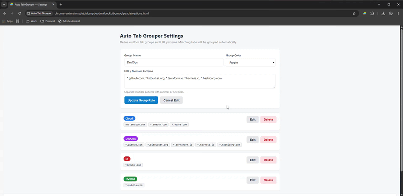

# 🧩 Auto Tab Grouper

A lightweight, high-performance browser extension for **Google Chrome** and **Microsoft Edge** that automatically organizes your tabs into custom color-coded groups based on user-defined domain and URL patterns.

## 🔗 Install
- **Chrome Web Store:** [Install AutoTabGrouper](https://chromewebstore.google.com/detail/ajpignjimcgbedghdkihgefdhmlpgahc)
- **Manual / Other Chromium Browsers (Edge, Brave):** Download `AutoTabGrouper-v1.0.0.zip` from **Assets** below, extract it, and load via `chrome://extensions` with **Developer mode** enabled.

## ✨ Features

- **Automatic Pattern Matching:** Supports wildcards (`*.github.com`) and bare domains.
- **Cross-Browser Color Support:** Fully compatible with both Chrome and Edge tab group palettes.
- **JSON Backup & Restore:** Easily export your custom rules and import them across different browsers.
- **Privacy First:** 100% local execution using `chrome.storage.sync`. No external tracking or data collection.
- **Manifest V3:** Built on modern, secure Chromium extension standards.

## 🚀 Installation (Developer Mode)

If you want to install it locally:

1. Clone or download this repository as a `.zip` file and extract it.
2. Open your browser and navigate to:
  - **Chrome:** `chrome://extensions`
  - **Edge:** `edge://extensions`
3. Enable **Developer mode** (toggle in the top right).
4. Click **Load unpacked** and select your project folder.

## ⚙️ Usage

1. Click the extension icon to open the **Settings Dashboard**.
2. Add a new Group Rule with your target Group Name, Color, and Domain Patterns (e.g., `*.amazon.com`).
3. Open matching URLs—they will instantly sort into their designated groups!

## 🤝 Contributing

Contributions, issues, and feature requests are welcome! Feel free to check out the [issues page](../../issues).

## 📄 License

Distributed under the MIT License. See `LICENSE` for more information.

## 👤 Author

**Nikhil Tamhankar**

- GitHub: [@theepicnik](https://github.com/theepicnik)
- LinkedIn: [Nikhil Tamhankar](https://www.linkedin.com/in/nikhiltamhankar/)
